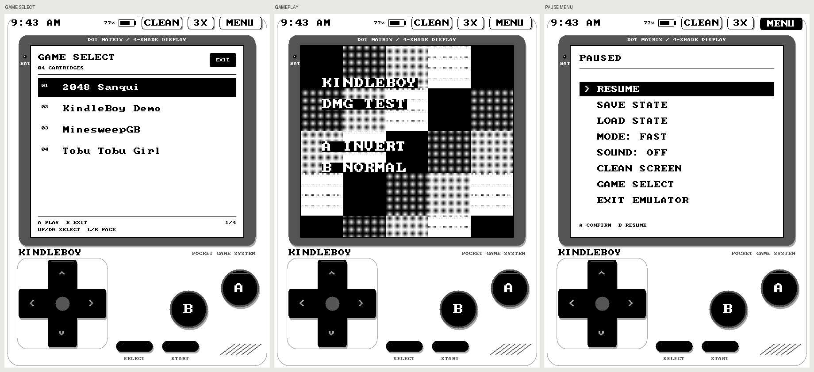
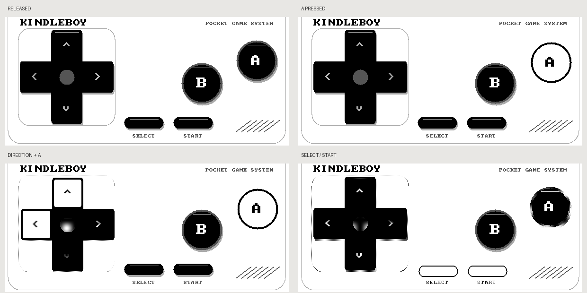

# kindleboy

把 **Kindle 第 8 代入门版（2016 / KT3）** 做成黑白 **Game Boy** 掌机。目标设备已根据序列号前缀 `G000K9` 确认，固件为 **5.15.1.1**。已在这台设备上验证灰度画面、A/B 操作、即时存档保存/读取和正常退出，并核对设备日志。

本项目基于 [itsParassharma/KindleBoy](https://github.com/itsParassharma/KindleBoy) 的 GPL 源码，使用 Walnut-CGB 模拟核心、FBInk 显示和触摸虚拟按键，支持游戏列表、四级灰度、消残影、即时存档和电池存档。来源、固定版本和修改见 [UPSTREAM.md](docs/UPSTREAM.md)。

**底层使用 Kindle 原有 Linux、内核和驱动。** 专用模式停止阅读界面，退出后恢复。开机启动通过独立的 Upstart 任务实现，每次开机运行一次，可从 USB 用户分区关闭。用户已确认 **KindleBoy Setup 显示 SUCCESS，重新启动后自动进入 Game Boy**。

## 安装

完整步骤见 [KT3 中文安装指南](docs/INSTALL_KT3.zh-CN.md)。

```powershell
# 检查连接的 Kindle（仅读取版本和已知安装路径）
powershell -NoProfile -ExecutionPolicy Bypass -File .\scripts\inspect-device.ps1

# 把已生成的软件包和官方越狱准备文件复制到确认过的 KT3
# H: 是本次检测到的盘符，重新连接后可能变化。
powershell -NoProfile -ExecutionPolicy Bypass -File .\scripts\install-device.ps1 -DriveRoot H:\ -StageJailbreak
```

`ExecutionPolicy Bypass` 仅对这一条 PowerShell 进程生效，不修改机器的永久执行策略。安装脚本验证校验值，备份被覆盖的相关文件，保留现有模拟器配置；不读取书籍内容或输出完整序列号。

**复制文件后仍需在 Kindle 上执行越狱。** 当前官方向导将 KT3 / 5.15.1.1 对应到 [WinterBreak2](https://kindlemodding.org/jailbreaking/WinterBreak2/)。现代越狱完成后，书库中的 `KindleBoy.sh` 是普通启动入口，`KindleBoy-Dedicated.sh` 是专用模式入口。旧 KUAL 菜单也保留在包内。

自备的 `.gb` 游戏放在 `roms/gb/`。包内只有本项目生成的黑白测试程序，不包含商业游戏。触摸组合按键、不同游戏的性能、休眠和长时间使用的残影仍需继续测试。

另已准备 [免费完整游戏包](games/README.zh-CN.md)：2048、MinesweepGB 和 Tobu Tobu Girl。它们是独立作者发布的游戏，来源、许可和导入方法随包保存。

专用开机模式的安装、验证和 USB 恢复步骤见 [安装指南第 4 节](docs/INSTALL_KT3.zh-CN.md#4-专用开机模式)。书库中的普通入口已经恢复，可通过 **KindleBoy Setup** 安装开机配置并查看明确结果。开发时另有一次性浏览器诊断入口。

## Game Boy 界面

界面采用经典掌机的深灰屏框、像素文字、十字方向键、错位圆形 A/B、SELECT/START 胶囊键和斜向扬声器格栅。游戏列表、游戏和暂停菜单共用同一套外壳。KT3 的游戏画面保持 **480 × 432（3 倍整数放大）**。



- 游戏列表：方向键上下选择、左右翻页，A 或 START 开始，B 退出；也可以直接触摸列表。
- 暂停菜单：顶部 MENU 打开；方向键选择、A 确认、B 返回，也可直接触摸菜单项。
- 顶部 CLEAN 清理残影，3X 切换三倍速；按键反白表示已开启。
- 游戏中方向键角落保留斜向输入，多个触点可以组合方向与 A/B。
- 按下时按键下沉、阴影收缩，A/B 反白、方向键高亮；松开后回弹。SELECT/START 和顶部功能键也有按压反馈。



游戏刷新限制在游戏区域，按压效果只刷新对应按键附近。按住不循环动画，快速短按会短暂保留视觉反馈；过密的更新合并到约 230 ms 一次，实际游戏输入仍即时传给模拟器。阴影使用适合快速黑白刷新的点阵纹理。按键刷新使用独立计时，避免持续操作重置游戏画面的等待时间。列表和菜单移动选择时只刷新屏框内的内容，以保留其余外壳。新界面和特效已通过电脑端布局/输入测试和截图检查，真机显示效果待本次更新后确认。

## 构建与验证

Windows 需要 Python 3 和运行中的 Docker Desktop：

```powershell
powershell -NoProfile -ExecutionPolicy Bypass -File .\scripts\build.ps1
```

若 Docker Hub 暂时不可达，可用 `-BuilderImage` 指定已有的 Debian 12 构建镜像（需有 `make`、`cc`、`file` 和基础 shell 工具）。本机已用现有的 `show/php-fpm:8.2.35-bookworm` 镜像完成构建验证；默认 Debian 构建镜像的首次下载受到本机 Docker Hub 网络故障影响。

构建脚本下载固定版本的依赖并核对工具链 SHA-256，运行电脑端模拟测试，生成静态 ARM soft-float 二进制，再打包：

- `dist/kindleboy-kt3-5.15.1.1.zip`：设备安装包和原始测试 ROM。
- `dist/kindleboy-source.zip`：对应源代码及第三方许可证。
- `dist/staging/manifest.json`：文件校验值和真机验证记录。

电脑端已验证 DMG 测试程序、8 项存档测试、启动器清理，以及 6 项专用启动/安装回滚和结果提示检查。UI 测试覆盖 600×800、800×1072、1072×1448 三种尺寸的按键边界、组合输入、列表翻页/空列表、暂停菜单、状态栏和绘制越界检查。普通模式的运行、A/B、存档保存/读取和退出有用户确认及设备日志；Setup 成功和重启自启由用户在真机确认。触摸组合按键、不同游戏的性能、休眠和长时间运行仍未在真机专项验证。

项目整体使用 GPL-3.0-or-later，第三方组件见 [NOTICE.md](NOTICE.md)。
